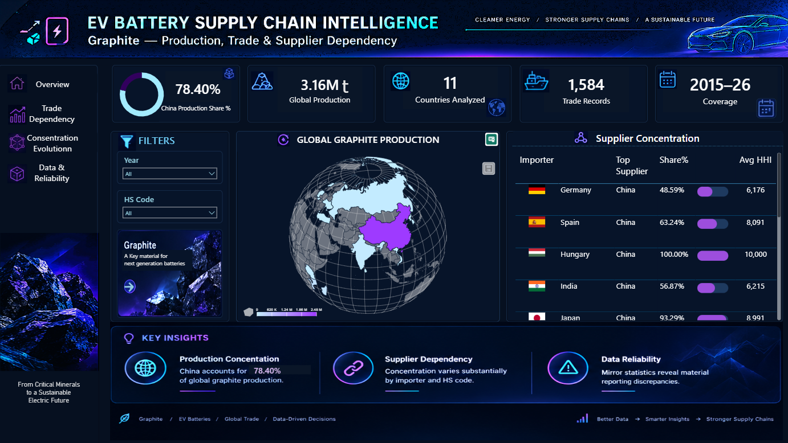
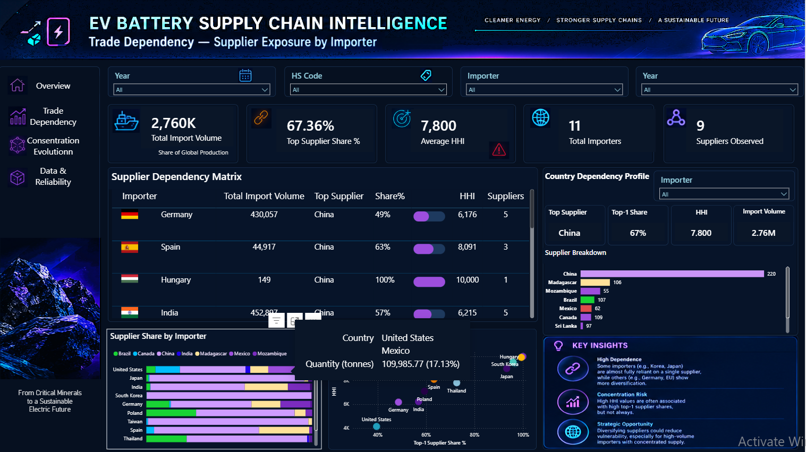
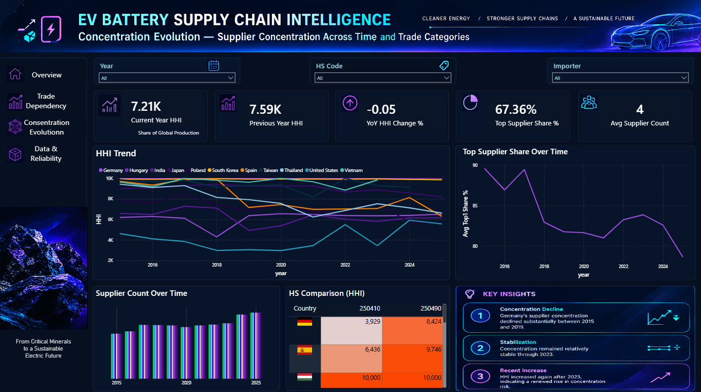
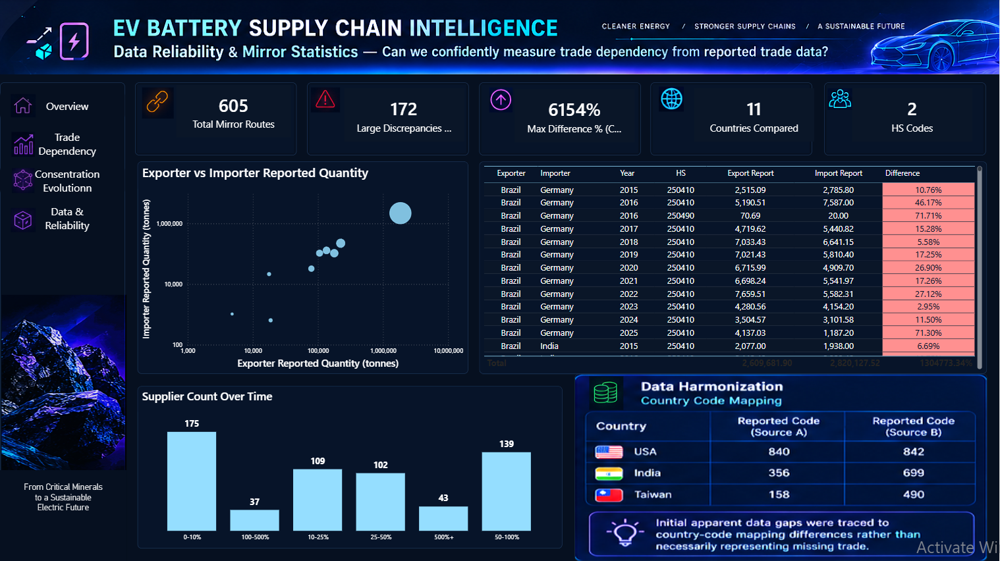

# EV Battery Supply Chain Intelligence

### From Critical Minerals to Battery Manufacturing

## See this in action

https://github.com/user-attachments/assets/15b273e8-e8a3-4c0a-adf3-ea52ce39c2a1

**Graphite Phase | Production, Trade Dependency, Concentration & Data Reliability**

This repository contains the graphite focused analytical implementation of a broader EV battery supply chain intelligence program. It investigates natural graphite production and international trade using public data, combining Python based data ingestion and transformation, relational data modeling in PostgreSQL, SQL analytics, data quality investigation, and a four page Power BI report.

The goal is not to build a generic dashboard. It is to establish a traceable analytical baseline for understanding production concentration, supplier dependency, concentration trends, and the reliability of reported trade data.

> **Scope note:** The findings are based on a selected set of countries, partners, years, HS classifications, and reporting perspectives. They are not a complete global graphite trade census. HS trade classifications are not treated as direct evidence of individual processing stages, and concentration metrics are not interpreted as risk by themselves.

---

## Project at a Glance

| Item | Current scope |
|---|---|
| Trade observations | 1,584 |
| Production observations | 38 |
| Active trade reporters | 13 |
| Partner countries in selected extraction | 10 |
| Trade classifications | HS 250410 and HS 250490 |
| Trade years queried | 2015–2026; coverage varies by year and reporter |
| Production years | 2023–2024 |
| Dashboard | Four-page Power BI report |

## Key Findings

The following findings describe the selected dataset and its analytical filters. They should not be interpreted as universal measures of national supply chain risk.

- **Production concentration:** China accounted for 78.94% of global natural graphite production in 2023 and 77.88% in 2024 in the assembled USGS based production dataset.

- **Supplier exposure:** A selected South Korea trade view showed a 98.95% supplier share attributed to China. This figure must be interpreted within the corresponding report filters and data coverage.

- **High observed concentration:** A selected Hungary trade slice produced an HHI of 10,000, indicating complete supplier concentration within that analytical slice.

- **Germany concentration trend:** In the analyzed Germany HS 250410 import series, HHI declined from 6,783 in 2015 to 2,730 in 2019, remained broadly between 2,700 and 3,100 through 2024, and increased to 3,341 in 2025.

- **Classification matters:** In the selected 2024 Germany import view, China represented 36.93% of the supplier share under HS 250410, compared with 99.62% under HS 250490. The corresponding selected import volumes were approximately 42,000 tonnes and 3,800 tonnes, respectively. This illustrates why supplier shares should be interpreted alongside market size and trade classification.

- **Mirror statistics:** Using Germany's importer reported record as the denominator, the matched 2023 Germany import and China export observations differed by approximately 30% in net weight and 41% in trade value. Germany reported 9,875.51 tonnes and USD 11,669,386 on a CIF basis, while China reported 6,893.27 tonnes and USD 6,875,968 on an FOB basis. The matched records also differed in reporting status and net weight estimation metadata. These differences document a mirror discrepancy, but do not establish which record is more accurate or identify a single cause.

**Interpretation principle:** HHI measures supplier concentration, not risk by itself. Supplier share, import volume, reporting coverage, trade classification, and data quality all affect interpretation.

## Explore the Power BI Report

The report is organized around four analytical questions.

### 1. Executive Intelligence

**Question:** What does the selected graphite supply-chain dataset look like?

A high-level view of production concentration, trade coverage, supplier concentration, and the main findings.



### 2. Trade Dependency

**Question:** How does supplier dependency vary across importing countries?

Compares supplier shares, leading suppliers, import profiles, and concentration indicators within the selected trade data.



### 3. Concentration Evolution

**Question:** How has supplier concentration changed over time?

Examines HHI trends, leading supplier shares, and differences between trade classifications where the data support comparison.



### 4. Data Reliability & Mirror Statistics

**Question:** How confidently can reported trade data be used to measure dependency?

Compares exporter- and importer-reported observations, highlights mirror discrepancies, and documents country-code harmonization issues.



## Data Sources and Classification

### USGS

The production dataset was assembled from the USGS Mineral Commodity Summaries 2025 graphite statistics. It contains 38 country-year observations covering 19 countries in 2023 and 2024.

[USGS Graphite Statistics and Information](https://www.usgs.gov/centers/national-minerals-information-center/graphite-statistics-and-information)

### UN Comtrade

Trade observations were collected through UN Comtrade for a selected set of reporters, partners, years, and natural graphite HS codes.

[UN Comtrade Plus](https://comtradeplus.un.org/)

The extraction retains exporter- and importer-reported perspectives for mirror comparisons. The selected coverage should not be described as a complete global trade matrix.

### HS Classification

| HS code | Description used in this project |
|---|---|
| 250410 | Natural graphite in powder or flakes |
| 250490 | Other natural graphite |

These codes distinguish trade classifications, not individual graphite processing stages. Trade records under these codes should not be assigned to specific processing stages without additional evidence.

## Analytical Methods

- **Production share:** A country's reported production divided by the corresponding global production total in the assembled dataset.
- **Supplier share:** A supplier's share of the selected importer's observed supplier distribution.
- **Top-1 share:** The share attributed to the largest supplier within the chosen analytical context.
- **Herfindahl-Hirschman Index (HHI):** The sum of squared supplier shares expressed in percentage points, ranging up to 10,000 when a single supplier accounts for the entire measured distribution.
- **Concentration trend:** Changes in HHI and supplier shares over time, subject to comparable data coverage.
- **Mirror statistics:** Comparisons of exporter- and importer-reported observations for matched trade contexts. Differences may reflect several factors, and their underlying causes cannot be inferred from the discrepancy alone.
- **Data harmonization:** Investigation of country-code differences that can otherwise create apparent gaps in retrieved data.
- **Observation quality metadata:** UN Comtrade reporting and quantity estimation flags, including `isReported`, `isNetWgtEstimated`, and `legacyEstimationFlag`, are retained as observation attributes. They help distinguish reported records from estimated observations and quantities. These flags are preserved rather than used as silent data exclusion filters.

The importer-reported perspective is used as the primary analytical choice for supplier dependency in this project. It is a methodological choice, not a claim that one reporting perspective is always correct.

## Technical Architecture

```text
USGS production data       UN Comtrade API
          |                      |
          v                      v
       Python ingestion and transformation
                      |
                      v
                  PostgreSQL
                      |
                      v
            SQL analytical views
                      |
                      v
              Power BI + DAX
                      |
                      v
       Four-page analytical report
```

## Technology Stack

- **Data ingestion and transformation:** Python, pandas
- **Database:** PostgreSQL
- **Database connectivity:** SQLAlchemy and psycopg2
- **Database client:** DBeaver
- **Analytics:** SQL views and validation queries
- **Visualization:** Power BI and DAX
- **Source data:** USGS and UN Comtrade

## Repository Structure

```text
.
├── data/
│   └── raw/
│       └── usgs/
├── docs/
│   ├── project_charter.md
│   ├── design_decisions.md
│   ├── trade_data_contract.md
│   └── mirror_statistics.md
├── powerbi/
│   ├── ev_battery_supply_chain_intelligence.pbix
│   └── theme_supply_chain.json
├── sql/
│   ├── ddl/
│   ├── reference/
│   └── analytics/
├── src/
│   ├── ingestion/
│   ├── cleaning/
│   ├── transformation/
│   └── loading/
├── assets/
│   ├── demo/
│   │   └── dashboard-preview.mp4
│   └── screenshots/
│       ├── 01-executive-intelligence.png
│       ├── 02-trade-dependency.png
│       ├── 03-concentration-evolution.png
│       └── 04-data-reliability-mirror-statistics.png
├── reports/
├── notebooks/
├── requirements.txt
└── README.md
```

## Documentation

- [Project Charter](docs/project_charter.md)
- [Design Decisions](docs/design_decisions.md)
- [Trade Data Contract](docs/trade_data_contract.md)
- [Mirror Statistics](docs/mirror_statistics.md)

## Running the Project

1. Clone the repository and install the Python dependencies listed in `requirements.txt`.
2. Configure PostgreSQL and API access using your own local environment settings.
3. Review the SQL DDL, reference-data, and analytics scripts before executing them in the intended order.
4. Open `powerbi/ev_battery_supply_chain_intelligence.pbix` using Power BI Desktop.

The PBIX report may require your own PostgreSQL connection configuration to refresh. Database credentials and local `.env` files are not part of the intended public setup.

Install Python dependencies with:

```bash
pip install -r requirements.txt
```

## Limitations and Responsible Interpretation

- The trade extraction covers a selected subset of reporters and partners; it is not a complete global census.
- Coverage varies by country, partner, year, HS code, and reporting perspective.
- A missing observation must not automatically be interpreted as zero trade.
- Production, trade, processing capacity, and battery demand are distinct measures and are not interchangeable.
- HS 250410 and HS 250490 do not identify individual processing stages.
- High HHI or high supplier share alone does not establish the probability or severity of a disruption.
- Mirror discrepancies do not, by themselves, identify the correct reporter or prove the reason for a difference.

## Roadmap

This project is the intelligence baseline for a broader three-project portfolio:

1. **Intelligence:** Understand production concentration, trade dependency, and data reliability.
2. **Geopolitical Exposure:** Examine how geographic and policy-related disruptions can affect supply exposure.
3. **Resilience and Diversification:** Evaluate scenarios and potential responses to supply-chain disruptions.

The current repository implements the graphite-focused intelligence phase. Future phases are planned extensions, not completed capabilities of this report.
